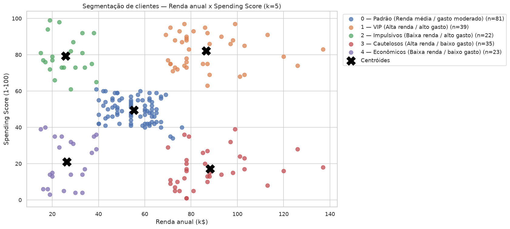
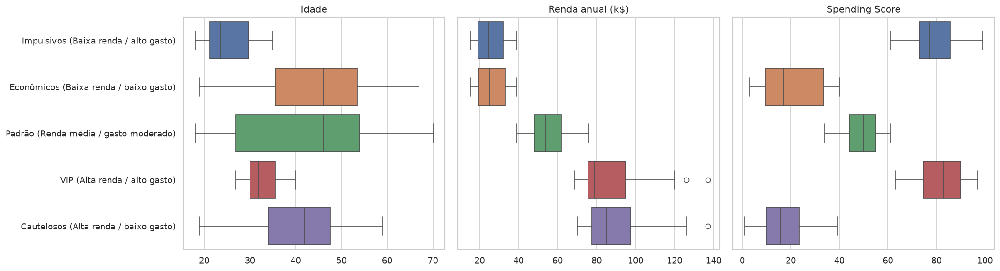

# Segmentação de Clientes com K-Means

Projeto final do **Módulo 33 — Modelos Avançados** do curso **Profissão Cientista de Dados**.

Uso o algoritmo de clustering **K-Means** para segmentar 200 clientes de um shopping com base em idade, renda anual e *Spending Score*. Depois interpreto os grupos e sugiro estratégias de negócio para cada um.

▶️ **Como rodar:** veja a seção [Como rodar](#como-rodar) (Docker, uv ou pip).

📓 **Notebook completo (executado):** [`notebooks/segmentacao_clientes_kmeans.ipynb`](notebooks/segmentacao_clientes_kmeans.ipynb)

---

## Dataset

[Mall Customers](data/Mall_Customers.csv): 200 clientes, 5 atributos. Dataset **fornecido pelo professor** do curso Profissão Cientista de Dados como material do projeto do Módulo 33 (é a mesma base pública [Mall Customer Segmentation Data](https://www.kaggle.com/datasets/vjchoudhary7/customer-segmentation-tutorial-in-python), do Kaggle).

| Coluna | Descrição |
|---|---|
| `CustomerID` | Identificador único do cliente |
| `Gender` | Gênero |
| `Age` | Idade |
| `Annual Income (k$)` | Renda anual (milhares de dólares) |
| `Spending Score (1-100)` | Pontuação de gasto atribuída pelo shopping |

## Metodologia

1. **Exploração de dados**: qualidade (nulos, duplicados, faixas válidas), estatísticas descritivas, distribuições, outliers (IQR), análise por gênero e correlações.
2. **Tratamento**:
   - `CustomerID` removido, porque é só um identificador.
   - `Gender` fica fora do modelo, já que não diferencia o consumo e é binário (distorce a distância euclidiana). Ele é usado só para descrever os clusters.
   - Os 2 outliers de renda foram mantidos, porque são clientes reais de alta renda.
   - Padronização com `StandardScaler`, porque o K-Means é sensível à escala das variáveis.
3. **K-Means** em dois cenários, com `k-means++`, `n_init=10` e `random_state=42`:
   - **A**: Renda + Score (2D)
   - **B**: Idade + Renda + Score (3D)
4. **Escolha de k**: método do cotovelo, silhueta, Davies-Bouldin e Calinski-Harabasz, testando k de 2 a 10.
5. **Avaliação e interpretação**: gráficos de silhueta, visualização dos clusters (com PCA no cenário 3D), perfil de cada segmento e aplicações práticas.

Cada etapa do notebook termina com um bloco **💡 Insights** que interpreta o resultado.

## Resultados

| Cenário | k | Silhueta ↑ | Davies-Bouldin ↓ | Calinski-Harabasz ↑ |
|---|---|---|---|---|
| **A: Renda + Score** | 5 | **0,555** | **0,572** | **248,6** |
| B: Idade + Renda + Score | 6 | 0,428 | 0,825 | 135,1 |

O **cenário A** foi escolhido como segmentação principal: as métricas são as melhores e os grupos são fáceis de comunicar. O cenário B reproduz os mesmos segmentos e divide o grupo "Padrão" em jovens e maduros.



### Segmentos identificados

| Segmento | Clientes | Idade média | Renda média (k$) | Score médio | Estratégia |
|---|---|---|---|---|---|
| **VIP** (alta renda / alto gasto) | 39 (19,5%) | 32,7 | 86,5 | 82,1 | Fidelidade premium, lançamentos, eventos exclusivos (retenção) |
| **Cautelosos** (alta renda / baixo gasto) | 35 (17,5%) | 41,1 | 88,2 | 17,1 | Segmento com maior potencial de crescimento: ofertas de valor/qualidade, conveniência |
| **Padrão** (renda média / gasto moderado) | 81 (40,5%) | 42,7 | 55,3 | 49,5 | Campanhas de volume, cross-selling, comunicação por faixa etária |
| **Impulsivos** (baixa renda / alto gasto) | 22 (11,0%) | 25,3 | 25,7 | 79,4 | Promoções relâmpago, fast fashion, parcelamento responsável |
| **Econômicos** (baixa renda / baixo gasto) | 23 (11,5%) | 45,2 | 26,3 | 20,9 | Liquidações, cashback, produtos essenciais |



### Principais insights

- A renda **sozinha não explica o gasto**. Os grupos VIP e Cautelosos têm renda parecida (~87 k$) e comportamento oposto.
- A **idade** tem relação com o gasto: clientes jovens gastam mais (correlação de −0,33 entre idade e score).
- O **gênero** praticamente não diferencia os segmentos.
- O maior **valor atual** está nos **VIP**. O maior **potencial** está nos **Cautelosos**.

## Limitações e próximos passos

- A base é pequena (200 clientes) e não tem dados transacionais nem temporais. Uma análise **RFM** enriqueceria a segmentação.
- A fórmula do *Spending Score* não é conhecida.
- Dá para comparar com DBSCAN, clustering hierárquico e Gaussian Mixture, e validar os segmentos com testes A/B.

## Estrutura

```
├── data/Mall_Customers.csv
├── notebooks/segmentacao_clientes_kmeans.ipynb
├── reports/figures/          # gráficos exportados pelo notebook
├── Dockerfile / .dockerignore
├── pyproject.toml / uv.lock
└── README.md
```

## Como rodar

Escolha **uma** das opções abaixo.

### Opção 0: só visualizar (sem instalar nada)

O notebook já está salvo com todos os resultados. Basta abrir
[`notebooks/segmentacao_clientes_kmeans.ipynb`](notebooks/segmentacao_clientes_kmeans.ipynb) aqui no GitHub.

### Opção 1: Docker (recomendado, funciona em qualquer computador)

**Pré-requisitos:** [Git](https://git-scm.com/downloads) e [Docker](https://docs.docker.com/get-docker/) instalados (no Windows/Mac, o Docker Desktop precisa estar aberto).

1. Baixe o projeto:
   ```bash
   git clone https://github.com/RToyoyama/customer-segmentation-kmeans.git
   cd customer-segmentation-kmeans
   ```
2. Construa a imagem (só na primeira vez; demora alguns minutos):
   ```bash
   docker build -t segmentacao-kmeans .
   ```
3. Inicie o container:
   ```bash
   docker run --rm -p 127.0.0.1:8888:8888 segmentacao-kmeans
   ```
4. Abra **http://localhost:8888** no navegador. O JupyterLab abre direto no notebook.
5. Para rodar tudo, use o menu **Run → Run All Cells**.
6. Para encerrar, aperte `Ctrl + C` no terminal.

> O Jupyter roda sem senha para facilitar o acesso local. Por isso a porta é liberada só em `127.0.0.1`, e o notebook não fica acessível para outras máquinas da rede.

**Executar o notebook sem abrir o navegador** (útil para conferir se tudo roda do início ao fim):

```bash
docker run --rm segmentacao-kmeans \
  jupyter nbconvert --execute --to notebook --stdout notebooks/segmentacao_clientes_kmeans.ipynb > /dev/null \
  && echo "Notebook executado com sucesso"
```

### Opção 2: uv (Python local)

**Pré-requisitos:** [Git](https://git-scm.com/downloads) e [uv](https://docs.astral.sh/uv/getting-started/installation/). O uv instala o Python 3.13 automaticamente.

```bash
git clone https://github.com/RToyoyama/customer-segmentation-kmeans.git
cd customer-segmentation-kmeans
uv sync
uv run jupyter lab notebooks/segmentacao_clientes_kmeans.ipynb
```

### Opção 3: pip (Python local)

**Pré-requisito:** Python 3.13 ou mais recente.

```bash
git clone https://github.com/RToyoyama/customer-segmentation-kmeans.git
cd customer-segmentation-kmeans
python -m venv .venv
# Linux/Mac: source .venv/bin/activate
# Windows:   .venv\Scripts\activate
pip install pandas numpy matplotlib seaborn scikit-learn jupyterlab
jupyter lab notebooks/segmentacao_clientes_kmeans.ipynb
```

**Stack:** pandas, numpy, matplotlib, seaborn, scikit-learn, Jupyter.

---

Autor: **Renan Toyoyama**
